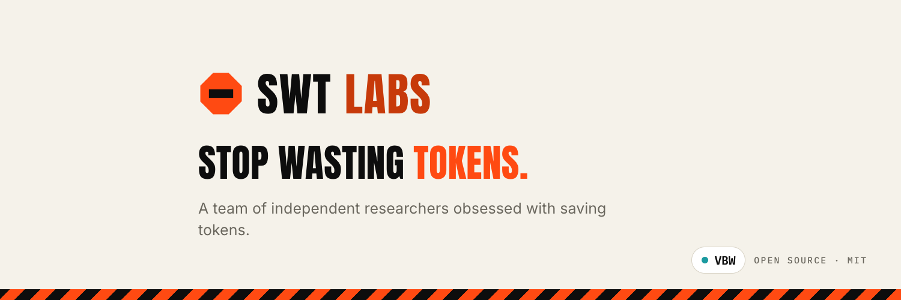
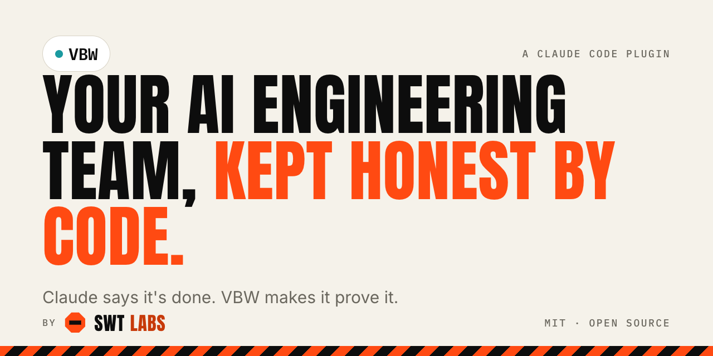

  

  
  
  

We build open-source tools that make AI agents cheaper and better.

## Flagship: VBW

**Vibe Better With Claude Code.** A Claude Code plugin. Claude says it's done; VBW makes it prove it.

[Repository](https://github.com/swt-labs/vibe-better-with-claude-code-vbw) · [Site](https://swt-labs-website.vercel.app/vbw/) · MIT

## Join in

Issues, ideas and pull requests are welcome on any of our repositories. The fastest way to talk to us is [Discord](https://discord.gg/zh6pV53SaP).
